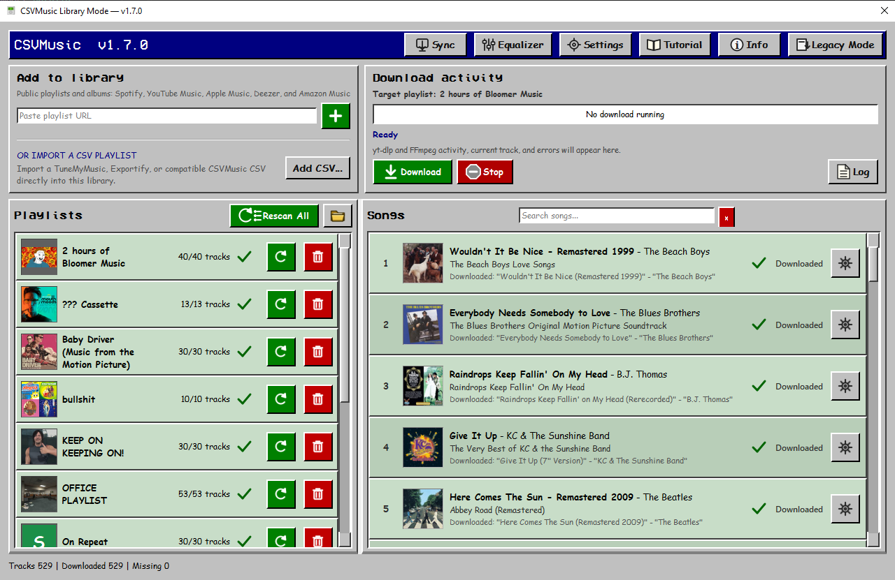

# CSVMusic

<table align="center">
  <tr>
	<td colspan="2"></td>
  </tr>
</table>

<h2 align="center"><a href="https://buymeacoffee.com/agalli">☕ Enjoying CSVMusic? Buy me a coffee</a></h2>

**Convert playlists and albums from music links or CSV exports into fully tagged audio files.**

CSVMusic accepts playlist and album links from supported music services, or a playlist exported as CSV from TuneMyMusic, and automatically:
- Finds the best match on YouTube Music
- Downloads the audio
- Adds metadata such as artist, album, and artwork
- Outputs ready-to-use **M4A** or **MP3** files, with optional native **Opus** output
- Optionally creates `.m3u` / `.m3u8` playlists

---

# Download

Go here:
https://github.com/angall1/CSVMusic/releases/tag/v1.7.9

Download one of the following based on your OS:

### Windows
https://github.com/angall1/CSVMusic/releases/download/v1.7.9/CSVMusic-windows.zip

### macOS (Apple Silicon)
https://github.com/angall1/CSVMusic/releases/download/v1.7.9/CSVMusic-macos-arm64.zip

### macOS (Intel)
https://github.com/angall1/CSVMusic/releases/download/v1.7.9/CSVMusic-macos-intel.zip

### Linux
https://github.com/angall1/CSVMusic/releases/download/v1.7.9/CSVMusic-linux.zip

Extract the ZIP before running the app. If your desktop does not launch the files directly, open a terminal in the extracted folder and run:

```bash
chmod +x CSVMusic yt-dlp
./CSVMusic
```

If Linux reports that the Qt `xcb` platform plugin could not be initialized, install the commonly required cursor runtime and retry:

```bash
sudo apt update
sudo apt install libxcb-cursor0
```

Additional Linux diagnostics are included in `README-LINUX.md` inside the release archive.

If launch fails, copy the terminal output along with `uname -m` and the contents of `/etc/os-release` when reporting the problem.

---

# Python Wheel / Source Install

Install the wheel with `python -m pip install CSVMusic-*.whl`, or install a source checkout with `python -m pip install -e .`.
Then launch CSVMusic with either:

```text
csvmusic
python -m csvmusic
```

Python installations still require a supported graphical desktop environment for the Qt interface. Android, Andronix, and other phone-hosted Linux environments are not currently supported or tested.

---

# What's New In 1.7.9

- Fixed localized Spotify album and playlist links, including `/intl-es/` URLs (#86).
- Prevented unrelated recommendations and numeric song titles from being captured as playlist rows (#85).
- Recognize existing accented filenames across equivalent Unicode encodings during library rescans. This addresses a reproduced missing-file case related to #84; the original download failure remains unconfirmed.
- Age-restricted downloads now explain how to enable cookies in **Settings → YouTube Account**, save, and retry. If cookies are already enabled, the error suggests reconnecting and checking account eligibility. The batch continues with the next song.
- Added optional YouTube account sign-in, connection checks, and browser/manual-cookie fallbacks. Selected sessions remain enabled throughout downloads.
- Added YouTube source-quality indicators, clearer legacy iPod MP3 encoding controls, a playlist-folder shortcut, and a scrollable rescan summary.
- Corrected JavaScript runtime arguments passed to yt-dlp.

<details>
<summary>What's New In 1.7.8</summary>

- #77: Apple Music imports now follow the public catalog's pagination when the page stops at 300 tracks. If pagination fails, the partial-import warning remains. No account login is required.
- #78: Rescans preserve filename numbering and audio-processing metadata. Older numbered files can be recovered when the filename match is unambiguous.
- #80: Downloads request full-size Spotify album artwork instead of embedding the tiny playlist-row thumbnail; the original URL remains a fallback. Existing audio files are not automatically retagged.
- #81: **Scan Unscanned** scans only playlists without a completed scan timestamp.
- #83: Settings → Advanced now exposes optional browser cookies and Netscape cookies files directly in Library Mode. Cookies are off by default, can contain account credentials, and do not guarantee protection from rate limits.
- Restored installed Comic Sans as the default body font, with bundled Comic Neue as the fallback on systems without it.
- #76/#82: macOS builds use an explicit native architecture and Monterey-compatible Qt 6.8.3. Release checks now extract the final ZIP, verify its signature, and exercise Qt/WebEngine startup. These changes still need native Apple Silicon/Intel build verification and a Monterey test; the ARM startup report is not yet confirmed resolved. The bundled media tools and experimental iPod helper also require verification on Monterey.

</details>

<details>
<summary>What's New In 1.7.7</summary>

## Library downloads, matching, and portable-player sync

- Added an optional numbered filename prefix (`01-`, `02-`, and so on), disabled by default, with matching M3U/M3U8 paths.
- Added **Download All**, which processes only missing tracks across the library and clearly identifies the playlists contributing work.
- Existing downloads are reprocessed when enabled equalizer settings change, while replacing a selected alternative removes the superseded local file.
- Improved YouTube Music matching for official translated titles with compatible durations and version markers.
- Fixed low-contrast alternative results on Linux and macOS desktop themes.
- Portable-player sync now checks playlist counts, order, and stable track identities; new or changed playlists are prioritized and selected by default.
- Fixed older iPod syncs falsely marking every playlist as changed, while preserving verification for explicitly selected alternatives.
- Reused iPod tracks now receive stable CSV Music identity metadata, playlist order is preserved, and helper processes remain hidden on Windows.
- Improved sync progress, selection locking, missing-helper guidance, and the download activity layout.

</details>

[Older updates and downloads](https://github.com/angall1/CSVMusic/releases)

---

# How It Works

1. Open the app. Library Mode is the default interface.
2. Paste a supported public playlist or album link, or click **Add CSV...** for a compatible CSV export.
3. Scan the added playlist, review any warnings or low-confidence matches, and select it.
4. Click **Download**, confirm the output settings, then click **Start Download**.

## Library Mode

Library Mode keeps multiple public Spotify, Apple Music, YouTube Music, and YouTube playlists in one persistent local catalog:

1. Paste a public playlist or album URL into **Add to library**, then click the green add button. Repeat for additional playlists; duplicate links are ignored.
2. Use **Rescan All** or the refresh button beside one playlist. Spotify uses the public-page scanner; other supported sources load public metadata directly.
3. Select a playlist and review its song states. Yellow entries need review; red entries still need downloading.
4. Click **Download**, configure the shared output folder and format, then click **Start Download**.
5. Use **Sync** if you want to copy selected completed playlists to a supported portable player.

The library is saved locally as `library.json` in CSVMusic's settings folder by default. **Save As...** can create a portable library file. Rescanning preserves track selections and manual YouTube corrections while reporting added and removed tracks.

For standalone development testing, launch only the Library Mode window with:

Windows PowerShell:

```powershell
.\.venv\Scripts\python.exe -m csvmusic.library_mode_ui
```

macOS or Linux:

```bash
./.venv/bin/python -m csvmusic.library_mode_ui
```

To fix a wrong download, select the track, click **Set YouTube Match...**, and paste the correct YouTube or YouTube Music video URL. That track is queued for replacement, and the replacement flag clears after a successful download. **Toggle Redownload** can also replace a track while retaining automatic matching.

CSV import is a standalone import method and can be used at any time. It is also useful when a service link is private, unsupported, incomplete, or cannot expose every track:

1. Click **Choose...** next to **Source**.
2. Select **CSV File**.
3. Use the TuneMyMusic link in that window if you need to create a CSV:
   - Choose the original music service as the source.
   - Paste the same playlist link, or connect the service if TuneMyMusic asks.
   - Export to file as a **CSV file**.
4. Load the CSV, choose an output folder, and click **Start**.

If a song cannot be matched confidently:
- It will show up highlighted in yellow.
- Click **Alternatives** to pick a better result.
- Use **Listen** to preview a candidate in your browser.

---

# What You Get

- Audio files with:
  - Correct artist/title
  - Album info
  - Embedded artwork
- Optional playlist files:
  - `.m3u`
  - `.m3u8`

Everything is ready to drop into iTunes, a phone, an MP3 player, or a local music library.

---

# Important Notes

- Keep all files in the extracted folder together.
- The packaged app includes:
  - `ffmpeg`
  - `yt-dlp`
  - `yt-dlp-ejs`
  - Deno
- Some antivirus software may flag bundled download/processing tools. These are usually false positives.
- Your CSV stays local. Direct links are fetched only to read public playlist or album metadata.
- YouTube Music / YouTube is contacted to search and download audio.
- Cookies are optional, but may help with age-restricted or sign-in-only videos.
- Current YouTube extraction requires a supported JavaScript runtime. Packaged releases include Deno and the needed `yt-dlp` extras; source installs should use `pip install -e .` and provide Deno 2.3+ or Node 22+.
- Private playlists or pages that hide track data may not import directly. If that happens, export a CSV from TuneMyMusic and load that instead.
- Spotify's public website can change without notice. Library Mode uses an experimental browser-based scanner for public playlists; review any incomplete-scan warning before downloading. TuneMyMusic CSV import remains available as an independent import method.

---

# Supported Sources

Direct link import supports public playlist or album pages from:
- Spotify
- Apple Music
- YouTube Music
- YouTube playlists
- SoundCloud sets
- Deezer
- Amazon Music, when the page exposes public track data

CSV import supports any service TuneMyMusic can export, including most other music platforms.

### Spotify Web API metadata test

An experimental metadata-only importer is available for testing Spotify Web API access. It retrieves playlist and track metadata and prints the normalized result as JSON. It does not save the access token.

For the guided graphical test, run:

```powershell
.\.venv\Scripts\python.exe -m csvmusic.spotify_api_test_ui
```

The graphical test is a four-page wizard:

1. Configure the Spotify Developer Dashboard, copy the callback URL, and check the callback port.
2. Enter the public Client ID, sign in with Spotify, and verify API access.
3. Search and sort your playlists, then select any number with checkboxes or **Check All**. Nothing is selected by default.
4. Load the selected playlists and click each playlist to expand its returned tracks.

Authentication uses Authorization Code with PKCE and never requires the Client Secret. The command-line procedure below remains available for troubleshooting.

Spotify currently exposes playlist items through Web API only when the signed-in user owns or collaborates on that playlist. Followed public playlists still appear in the user's playlist list, so the wizard automatically falls back to Spotify's public page metadata when Web API returns this access restriction. Fallback playlists are labeled in the results and may be partial when Spotify's public page does not expose every track.

An additional unsigned-browser experiment can render and scroll a public playlist without Spotify credentials:

```powershell
.\.venv\Scripts\python.exe -m csvmusic.spotify_public_scrape_ui
```

It uses a temporary, non-persistent browser profile and captures only track rows Spotify renders publicly. Spotify may display a sign-in wall or stop exposing additional rows, so this does not guarantee a complete playlist.

#### One-time Spotify setup

1. Sign in to the [Spotify Developer Dashboard](https://developer.spotify.com/dashboard). Spotify currently requires a Premium account for Development Mode apps.
2. Select **Create app**. A suggested name is `CSVMusic Local Test`.
3. Enter `CSVMusic playlist metadata test` as the description.
4. Add `http://127.0.0.1:3000/callback` as the redirect URI. The current command-line test does not receive this callback, but registering it prepares the app for the planned desktop PKCE login.
5. In **Which API/SDKs are you planning to use?**, check **Web API** only. Leave **Web Playback SDK**, **Ads API**, **Android**, and **iOS** unchecked. CSVMusic only needs Web API access to request playlist and track metadata; it does not use Spotify playback, advertising, or mobile SDKs.
6. Accept Spotify's terms and create the app. Spotify's official [app setup documentation](https://developer.spotify.com/documentation/web-api/concepts/apps) explains each field.
7. Keep the app's **Client Secret** private. Do not add it to this repository, settings, or a packaged EXE. The eventual desktop integration will use [Authorization Code with PKCE](https://developer.spotify.com/documentation/web-api/tutorials/code-pkce-flow), which requires only the public Client ID in the application.

#### Get a temporary token for this test

1. Open Spotify's [Get Playlist Items reference](https://developer.spotify.com/documentation/web-api/reference/get-playlists-items).
2. Sign in and use its **Try it** authorization control to create a user access token. If testing a private playlist, authorize `playlist-read-private`.
3. Copy only the generated access-token value. Do not paste the 32-character **Client ID** from the app settings: it identifies your app but cannot authorize an API request. Never paste the **Client Secret**. Spotify access tokens normally expire after one hour; see Spotify's [access-token documentation](https://developer.spotify.com/documentation/web-api/concepts/access-token).
4. In PowerShell, from the CSVMusic repository, set the token for the current terminal and run the importer:

```powershell
$env:SPOTIFY_ACCESS_TOKEN = "your-access-token"
.\.venv\Scripts\python.exe -m csvmusic.fetch_spotify_api "https://open.spotify.com/playlist/PLAYLIST_ID"
```

Replace `PLAYLIST_ID` with the playlist link or paste the complete Spotify playlist URL between the quotes. Under Spotify's current Development Mode rules, the signed-in user must own or collaborate on the playlist. A `401` means the token is missing or expired; a `403` generally means the user or app cannot access that playlist.

Remove the token from the terminal when finished:

```powershell
Remove-Item Env:SPOTIFY_ACCESS_TOKEN
```
